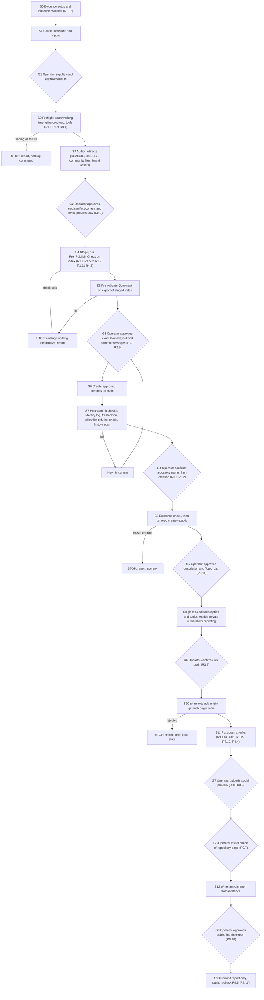

# Design Document

## Overview

This design describes how Lathe is published as a public GitHub repository under `ousssamarahmani`. It is a publishing procedure, not application code. It adds no runtime module and no dependency to the repository.

The design covers six things:

1. The ordered pipeline, with the stop points (gates G1 to G9) where the Human_Operator must confirm.
2. The artifacts to create or edit, and their content structure.
3. Each check, with its exact PowerShell command and how its result is recorded.
4. How each requirement maps to a step.
5. Failure handling and rollback.
6. How the procedure itself is verified.

### Design decisions in brief

| Decision | Choice | Rejected alternative | Reason |
|---|---|---|---|
| Executor | Human_Operator runs publishing commands; agents draft files and run read-only checks | One agent performs everything | `.github/**` is devops-owned and protected, `SECURITY.md` is security-owned, `README.md` is documentation-owned (`docs/agents/team.md` §3). R7.9 allows the Human_Operator to perform the change. The Human_Operator holds the only GitHub credential. |
| Helper scripts | Temporary scripts in `$env:TEMP\lathe-launch\` (outside the workspace). The report records each script's SHA-256 and the command that ran it | Scripts under `scripts/` | R10.1 does not list `scripts/`. Adding files there would violate the allow-list. |
| Evidence before the report | Evidence is appended to `$env:TEMP\lathe-launch\evidence.jsonl` as each check runs. The launch report is assembled from it at the end | Create the report file at the start | R10.7 says "record the baseline manifest in the launch report before any file change", but creating the report is itself a file change. See Conflict C3. |
| Secret scanner | gitleaks binary, pinned version, run from a temp directory | `npx` scanner; regex-only script | See "Secret scanner choice". |
| Preview image | Windows PowerShell 5.1 with `System.Drawing` | Node script with an image library | No new dependency (R8.6). See "Social preview". |
| Commits | Three Conventional Commits, approved as an exact list at G2 | One commit; many commits | Readable history, small enough to review. |

### Conflicts and ambiguities surfaced (not silently decided)

| ID | Conflict | Resolution proposed here | Needs human decision |
|---|---|---|---|
| C1 | R5.11 (fresh clone of committed `main`) needs commits to exist. R2.7 forbids commits before approval. R10.8 compares after commit and before push. | Commits are created only after G2 approval. Verification then runs on the local commits, before any push. If verification fails, a fix is a new commit with a new G2 approval (R2.9). No amend and no history rewrite. To make failure rare, the Quickstart is pre-validated on an export of the staged index before the commits (step S6). | Confirm that a fix commit with re-approval is acceptable. |
| C2 | R9.5 requires an empty `git status --porcelain` right after push, before the launch report is written. R9.9 and R9.10 then add the report and push it. | Run R9.5 first. Write the report only after all checks have run. After the report commit and push, R9.11 repeats R9.5. Both runs are recorded. | None, confirm only. |
| C3 | R10.7 says the baseline manifest is recorded in the launch report before any file change. Creating the report is a file change. | Record the manifest first in `$env:TEMP\lathe-launch\baseline.tsv` (blob ids are also stored in `.git/objects` by `git hash-object -w`). Copy it into the launch report at the end. | Confirm. |
| C4 | R1.11 flags absolute local paths and email-like strings. The spec files themselves contain such strings: the workspace path in the Local_Repository glossary entry and in R1.11 itself, and the noreply address pattern in R2.4. A design-time search found path matches only in `requirements.md` at lines 33 and 68. Email matches are expected from R2.4 and were not searched. | These are matches under R1.12. Either the Human_Operator approves each file and line, or the strings are edited. This design file avoids writing those literal strings. The commands below use a character-class regex for that reason. | Approve or edit, per match. |
| C5 | R1.7 requires `.kiro/agents/` and `.kiro/steering/` in the Commit_Set "for any commit". With split commits, an early commit may not contain `.kiro`. | The checks run against the cumulative index (`git ls-files --cached`). Commit 1 includes `.kiro/`, so the check holds for every commit. | None. |
| C6 | R5.2 requires each link-row link to resolve to a file, an anchor or an external URL. "Code" naturally points to a directory. | Use anchors and files (see the README skeleton). | Confirm link row targets. |
| C7 | R5.10 states the Node version from `.nvmrc` (22). The host runs Node 24. | The fresh-clone run uses the host Node (24). The README states 22, the `.nvmrc` value, and `engines` allows 22 or higher. The report records the host version used. | None, confirm only. |
| C8 | Quickstart checks run `pnpm install` inside a clone. R10.8 warns about `pnpm-lock.yaml` changes. | Run only in the temp clone, never in the workspace. After the run, `git status --porcelain` inside the clone must be empty. Otherwise a lockfile or other tracked change was caused by install and is reported. | None. |

## Architecture

### Pipeline with gates

Human gates are G1 to G9. Automatic stop conditions are drawn as "stop" nodes.



### Interaction sequence

```mermaid
sequenceDiagram
    actor H as Human_Operator
    participant P as Publishing_Procedure
    participant G as local git
    participant GH as gh CLI
    participant R as GitHub

    P->>G: S0 baseline manifest (hash-object, ls-files)
    P->>H: G1 inputs needed (identity, name, holder, contact, loop option, comments.json, topics)
    H-->>P: inputs and decisions
    P->>P: S2 scan, S3 author files
    P->>H: G2 artifacts for review
    H-->>P: approve
    P->>G: git add, S4 and S5 checks
    P->>H: G3 exact file list and messages
    H-->>P: approve (bound to hash of list and messages)
    P->>G: git commit x3
    P->>G: S7 clone to temp dir, run Quickstart, diff against baseline
    P->>H: G4 confirm name and creation
    H-->>P: confirm
    P->>GH: gh repo view (must fail: no such repo)
    P->>GH: gh repo create --public
    GH->>R: create empty repository
    P->>H: G5 description and topics
    H-->>P: approve
    P->>GH: gh repo edit, private-vulnerability-reporting PUT
    P->>H: G6 confirm first push
    H-->>P: confirm
    P->>G: git remote add origin; git push origin main
    G->>R: push main
    P->>GH: S11 verification queries
    P->>H: G7 upload social preview in web UI
    H->>R: Settings, General, Social preview
    P->>H: G8 visual check
    P->>H: G9 approve report
    P->>G: commit and push report
```

### Step ownership

| Step | Who runs it | Why |
|---|---|---|
| S0, S2, S4, S5, S7, S11 (read-only checks) | Any agent role, or the Human_Operator | No write outside temp dirs and the index. |
| S3 authoring | Per `docs/agents/team.md` §3: `documentation` (`README.md`, `CONTRIBUTING.md`, brand assets, report), `security` (`SECURITY.md`), `devops` (`.github/**`, `LICENSE`, root `package.json`, `.gitignore`), `architect` (spec files). Alternatively the Human_Operator edits all. | Single writer per path. A role that does not own a path files a handoff (R7.9). |
| S6, S8 to S10, S13 (commit, create, edit, push) | Human_Operator, or an agent only while the Human_Operator is present at the gate | Hard to reverse. Agents never merge or deploy (agent-workflow). |
| G7 (social preview) | Human_Operator only | Web UI only. |

## Components and Interfaces

### Secret scanner choice (R1.1 to R1.4)

| Option | Strength | Weakness |
|---|---|---|
| **gitleaks binary (recommended)** | Maintained rule set, works on a directory (`dir`), on the staged index (`git --staged`) and on history (`git`). `--redact` keeps values out of output (R1.3). | Not confirmed installed. Needs Human_Operator approval to download. |
| `npx` scanner (for example secretlint) | No separate install | Downloads and runs unpinned npm code that reads the whole tree. Weaker rule set. Same approval need. |
| Regex fallback script | No download | Home-made, low recall. Cannot claim equivalence. |

**Recommendation:** gitleaks, release binary pinned to a stated version, downloaded from the official GitHub releases page, SHA-256 compared with the published checksums file, unpacked into `$env:TEMP\lathe-launch\tools\`. It is not added to PATH, not added to the repository and not a dependency. The Human_Operator approves the download at G1 (per Security rule: new tools with security impact need approval). I did not verify that gitleaks is installed or which version exists. The step records the version actually used.

If the Human_Operator declines, there is no scanner, so R1.4 applies: the procedure stops. The Human_Operator may instead choose the regex fallback as the Secret_Scanner. In that case the report marks it "weaker, accepted by <name> on <date>". The fallback is never silently substituted.

Invocation (pinned flags, one config file in the temp dir):

```powershell
# $cfg: [extend] useDefault = true ; [allowlist] paths = ['''node_modules/''', '''\.git/''']
# leak exit code is set to 2 so that exit 1 (tool error in some versions) is not mistaken for a finding
& $gl dir "." --config $cfg --redact --no-banner --exit-code 2 --report-format json --report-path $rep   # R1.1 working tree
& $gl git --staged --config $cfg --redact --no-banner --exit-code 2 --report-format json --report-path $rep   # R1.2 index
& $gl git --config $cfg --redact --no-banner --exit-code 2 --report-format json --report-path $rep   # history after commits
```

Verdict function (Property 1): exit 0 and zero findings in the report is a pass; exit 2 or any finding is a leak; any other exit code, a missing binary or an unreadable report is a tool error. A leak and a tool error both stop the procedure. Subcommand names (`dir`, `git --staged`) are from recent gitleaks versions. If the pinned version lacks them, the step records the command that works for that version before use.

### Evidence recorder

A function in `$env:TEMP\lathe-launch\evidence.ps1` wraps every check. It appends one JSON line per run to `evidence.jsonl` (format under Data Models). Output excerpts are capped at 20 lines (R5.11) and redacted: no secret values, no tokens, no scanner match text. The report copies from this file.

### Artifacts

#### README.md (R5, R6)

Rewritten in place. Fixed skeleton:

```
<div align="center">
  
  <h1>Lathe</h1>
  <p>TAGLINE (at most 100 characters, same text as the preview image)</p>
  <p>Code · Docs · How it works · Architecture</p>
</div>

> STATUS CALLOUT (at most 8 source lines): pre-alpha. Kiroween 2026, Skeleton Crew.
> Existing/Partial: <components with report evidence>. Proposed: <everything else>.

## What Lathe is
## The loop
## Architecture
## Repository layout
## Reference apps
## Quickstart
## How Kiro is used
## Contributing
## Security
## License
```

Rules:

- Header, link row and callout take at most 30 source lines and come before the first `##` (R5.3).
- The ten `##` titles are exactly those above, in that order, with no others (R5.5).
- Proposed tagline (Human_Operator confirms): "A verified mini software factory for agent-native development." This is 62 characters. The same string is rendered in the preview image.
- Proposed link row targets (C6): Code → `#repository-layout`, Docs → `docs/architecture/01-system-architecture.md`, How it works → `#the-loop`, Architecture → `ARCHITECTURE.md`. No "Website" link.
- Logo display width is set with `width="120"`. The source is about 1024 px wide, so 120 gives a compact header. The Human_Operator may change this at G2.
- **The loop**: written from the option chosen at G1 (R6). Option (b) mapping text follows R6.3. In all options it says Ship (DELIVER) is a draft PR that a human approves and merges, and that no agent merges or deploys (R6.5).
- **Status labels (R5.4)**: a status table lists each component with one label. Existing or Partial requires a named task report in `docs/reports/` with recorded test output. The design-time inputs are `P0-02-devops.md` and `P0-03-architect.md`. The author reads them at S3 and records, for each Existing or Partial label, the report path. Everything else is Proposed. The loop and the two apps are Proposed.
- **Repository layout**: lists directories that exist in the Commit_Set unlabeled, and `apps/`, `services/`, `integrations/`, `templates/`, `packages/shared-contracts` labeled Proposed (R5.8).
- **Architecture**: links `ARCHITECTURE.md` and every `docs/architecture/*.md` file in the Commit_Set (R5.7).
- **Quickstart**: the commands that exit 0 in the fresh clone, in the order install, typecheck, lint, test, plus the Node (22, from `.nvmrc`) and pnpm (9.15.9, from `packageManager`) versions read from the files at S3 and re-compared at S7 (R5.10). `format:check` passes locally but is not in the R5.10 list and is not listed.
- **How Kiro is used**: links `docs/kiro-usage.md` and `AGENTS.md`. Dev-time use and runtime use (Proposed) are in separate lists (R5.13).
- No badges, screenshots, counts, or CI badge while `.github/workflows/` is empty (R5.15, R5.16).

#### LICENSE (R4)

The SPDX `MIT` text, with the single line `Copyright (c) 2026 <holder name>`, no other text before or after. Created at the repository root. Root `package.json` gets one new field `"license": "MIT"` and no other change (R4.7).

#### CODE_OF_CONDUCT.md (R7.1, R7.2, R7.13)

Short file: states adoption of Contributor Covenant version 2.1, links its canonical URL, names the Human_Operator's contact method as the only reporting channel. Created only after the contact method is supplied. If the contact is an email address, it is a match under R1.11 and needs approval.

If the community profile later reports the code of conduct absent (adopted by reference), the Human_Operator chooses between the full unmodified Covenant text plus contact, or keeping the short file (R7.13). No change is made until the choice is recorded.

#### SECURITY.md (R7.3, R10.2)

Only the body under the final `## Reporting` heading changes. The existing placeholder sentence is replaced with:

- a link to `https://github.com/ousssamarahmani/<name>/security/advisories/new`;
- a statement that vulnerabilities must not be reported in public issues, pull requests or discussions.

All other lines, including the "Status: Proposed" line, stay as they are.

#### CONTRIBUTING.md (R7.5)

Only Markdown link targets or link text change, and only to files that exist in the Commit_Set.

#### GitHub templates (R7.6 to R7.10, devops-owned)

| File | Content |
|---|---|
| `.github/ISSUE_TEMPLATE/bug_report.yml` | Issue form with `name`, `description`, `body`. Required fields: steps to reproduce, expected behavior, actual behavior, environment (OS, Node version, pnpm version). Field types limited to `markdown`, `input`, `textarea`, `dropdown`, `checkboxes`. |
| `.github/ISSUE_TEMPLATE/feature_request.yml` | Same structure. Required fields: the problem, the proposed change. |
| `.github/ISSUE_TEMPLATE/config.yml` | `blank_issues_enabled: false`. One `contact_links` entry labeled for security reports pointing to the advisory URL above. |
| `.github/pull_request_template.md` | Fields for task ID and branch name (`task/<ID>-short-name`), then eight unchecked items in this order: objective, files, decisions, tests executed, test results, remaining issues, blockers, next task. |
| `.github/workflows/**` | Not created (R7.10). |

#### Brand assets (R8)

- `docs/assets/brand/lathe-logo.png`: supplied by the Human_Operator (the logo is not on disk). The procedure checks the PNG signature and that width and height are at least 1 px by reading header bytes.
- `docs/assets/brand/lathe-social-preview.png`: generated, see below.

##### Social preview (R8.2 to R8.7)

**Choice: Windows PowerShell 5.1 (`powershell.exe`) with `System.Drawing` (GDI+).** It is part of Windows, needs no install and adds no dependency. A Node script would need an image library as a new dependency, which R8.6 forbids without approval. `pwsh` 7 can also load `System.Drawing` on Windows, but 5.1 is the safer path. If GDI+ is unavailable, the procedure stops and asks the Human_Operator to approve a tool or supply the image (R8.6).

Algorithm:

1. Create a 1280 by 640 bitmap at 96 DPI. Fill it with the background color sampled from the logo's top-left pixel, so the logo's own dark surround blends in. If the logo has a visible border, it is kept as part of the logo.
2. Scale the logo to a height of 300 px with the aspect ratio kept (about 374 by 300 for a 1024 by 822 source), high-quality bicubic. Place it left, vertically centered, at x = 120.
3. Draw the word "Lathe" (Segoe UI Semibold, about 96 px) and the tagline (Segoe UI, about 32 px, wrapped to the free width) to the right of the logo, in near-white. If the font is missing, the step stops and reports it.
4. Save as PNG.
5. Verify without `System.Drawing`: read the PNG signature and IHDR (bytes 16 to 23, big-endian width then height) and the file length. Require width 1280, height 640, length under 1,000,000. A flat two-tone image of this kind is expected to be far below the limit.
6. Verify margins: scan every pixel. A pixel is "content" if any channel differs from the background by more than 8. The bounding box of content pixels must be at least 40 px from all four edges.
7. Record the command and the output (width, height, bytes, bounding box) in evidence (R8.4). Show the image to the Human_Operator for a yes or no (R8.7). If any check fails, the image is not staged (R8.5).

#### Launch report (R9.9)

`docs/reports/github-repository-launch-<role>.md`, written in the eight-part format of `agent-workflow.md`:

1. Objective completed (task ID or spec name; "partially completed" if so)
2. Files created or modified (from the allow-list diff)
3. Technical decisions, each with the rejected alternative
4. Tests executed (exact commands, from `evidence.jsonl`)
5. Test results (counts, output excerpts, exit codes, pass/fail per check, the Human_Operator's G8 confirmation)
6. Remaining issues (for example "social preview upload: pending, manual"; private vulnerability reporting status; avatar note R8.11)
7. Dependencies or blockers
8. Recommended next task (P0-06 CI is the next gate for workflows)

Appendices: A baseline manifest; B decision records; C allow-list diff and partial-edit diffs; D README link table (R5.18); E scanner and approval records; F the two third-party-text exceptions with sources (MIT text from SPDX, Contributor Covenant 2.1 by reference; R10.4); G script SHA-256 list.

### Check catalogue (exact commands)

All run in PowerShell from the workspace root unless "temp" is stated. `$o` is `ousssamarahmani` and `$n` the confirmed repository name. Every command is wrapped by the evidence recorder.

| ID | Req | Command or procedure | Pass condition |
|---|---|---|---|
| K0 | R10.7 | `git ls-files --others --cached --exclude-standard` piped through `git hash-object -w -- <path>`, written as `blobId<TAB>path` to `baseline.tsv` | File written. `git hash-object` applies the same clean filters as `git add` (`core.autocrlf=true`, `.gitattributes` LF rules), so ids are comparable to `git ls-tree`. Use `-c core.quotepath=false`. |
| K1 | R2.2 | `git config --global --list; $LASTEXITCODE` and `git config --system --list; $LASTEXITCODE`, saved before the first config change and after the last commit | Outputs and exit codes identical. The procedure never touches `core.autocrlf`. LF/CRLF warnings on `git add` are expected and not errors. |
| K2 | R1.1 | gitleaks `dir` command above | Verdict pass |
| K3 | R1.9 | `git check-ignore -v .kiro; git check-ignore -v .kiro/agents/x` and `Select-String -Path .gitignore -Pattern '^\s*!?/?\.kiro' -n` | `check-ignore` exit 1 (no match) and no pattern line. The current `.gitignore` has no `.kiro` pattern. |
| K4 | R8.1 | Read the first 24 bytes of the logo file: signature `89 50 4E 47 0D 0A 1A 0A`, width and height at least 1 | Valid |
| K5 | R1.10 | `Test-Path comments.json` | Absent, or decision recorded (D-comments) |
| K6 | R2.3, R4.2, R3.1 | Validators over supplied inputs (see Properties 4 and 5) | Valid |
| K7 | R1.2 | gitleaks `git --staged` command above | Verdict pass |
| K8 | R1.5 | `git ls-files --cached \| Where-Object { $_ -match '(^\|/)\.env(\.(?!example$)[^/]+)?$' -or $_ -match '\.(pem\|key\|p12\|pfx)$' -or $_ -match '(^\|/)id_rsa' -or $_ -match '(^\|/)node_modules/' }` | No output |
| K9 | R1.6 | `git show :.env.example` (staged content), every line against `^$\|^#\|^[A-Za-z_][A-Za-z0-9_]*=$` after stripping a trailing CR | All lines match |
| K10 | R1.7 | `git ls-files --cached .kiro/agents .kiro/steering` and K3 | Both directories have at least one file; K3 clean |
| K11 | R4.3 | `git ls-files --cached` filtered for root `LICENSE`, `LICENSE.md`, `LICENSE.txt`, `COPYING*` | Exactly `LICENSE` |
| K12 | R1.11 | `git grep --cached -n -I -i -E "C:[\\/]+Users[\\/]"` ; `git grep --cached -n -I -i -E "[A-Za-z0-9._%+-]+@[A-Za-z0-9.-]+\.[A-Za-z]{2,}"` ; a phone pattern such as `(\+\d{1,3}[ .-]?)?(\(?\d{2,4}\)?[ .-]){2,}\d{2,4}` | Every match is listed as file, line, category (path, email, phone). Each needs a recorded approval or removal. The phone pattern over-matches (versions, hashes). Those are reported and approved in one batch by the Human_Operator, not filtered silently. `~/.kiro/...` is not matched by any of the three. |
| K13 | R1.13 | Hash the index (`git write-tree`) after each passing run. If the tree id differs from the last verified one, rerun K7 to K12. | Latest tree id equals the verified tree id before commit and before push |
| K14 | R2.5 | Each commit message first line against `^(feat\|fix\|docs\|chore\|build\|ci\|refactor\|test\|style\|perf)(\([^)]+\))?: .+$` and length at most 72 | Match |
| K15 | R2.6 | `git branch --show-current` immediately before each commit | `main` |
| K16 | R2.10 | `git log --format="%an\|%ae\|%cn\|%ce\|%s" main` and `git branch --list` | Author and committer equal the recorded identity, K14 holds for every subject, only `main` exists |
| K17 | R5.10 to R5.12 | Pre-validation (S5): `git checkout-index -a --prefix=<temp>/pre/` of the staged index, then in that directory `pnpm install`, `pnpm typecheck`, `pnpm lint`, `pnpm test`. Formal run (S7): `git clone --no-hardlinks <workspace> <temp>/fresh` (checks out committed `main`), then the same four commands. | Exit 0 for each command that the README lists. After the run, `git status --porcelain` in the fresh clone is empty. The temp directory is outside the workspace and has no `node_modules` before install. If `pnpm install` fails the procedure stops. If another command fails, the command is removed from the README (a new commit, new G3) or the procedure stops (R5.12). |
| K18 | R5.18, R5.19 | Link checker over the README: relative links and images checked with `Test-Path` against `git ls-files`, anchors against the README `##` headings after GitHub slug rules, external URLs with `Invoke-WebRequest -Method Head` | Table in Appendix D, all "resolves" |
| K19 | R10.8 | Compare `baseline.tsv` with `git ls-tree -r HEAD` (mode, blob id, path). For each partial-edit file also run `git diff <baselineBlob> HEAD:<path>`. | Changed paths are a subset of the R10.1 list, and each partial-edit diff meets R10.2 (Property 8) |
| K20 | R1.1 | gitleaks `git` (full history) | Verdict pass, before push |
| K21 | R3.2 | `gh repo view $o/$n` | Non-zero exit (not found). Success means a conflict: stop (R3.3). |
| K22 | R3.2 | `gh repo create $o/$n --public` (no `--source`, `--push`, `--clone`) | Exit 0. On failure: `gh repo view $o/$n`, report, no retry (R3.12). |
| K23 | R3.4, R3.6 | `gh repo edit $o/$n --description "<approved>" --add-topic <t1> --add-topic <t2> ...` | Exit 0. Homepage left empty. |
| K24 | R7.4 | `gh api -X PUT repos/$o/$n/private-vulnerability-reporting -i` | HTTP 204. Otherwise follow R7.11 and mark "not enabled" until the Human_Operator confirms. |
| K25 | R3.9, R3.10 | `git remote add origin https://github.com/$o/$n.git` then `git push -u origin main` | Exit 0, no force flag, only `main` |
| K26 | R3.8 | If the default branch is not `main`: `gh repo edit $o/$n --default-branch main` | `defaultBranchRef.name` is `main` |
| K27 | R9.1, R9.2 | `gh repo view $o/$n --json visibility,description,homepageUrl,repositoryTopics,licenseInfo,defaultBranchRef` | Verdict per Property 13. License retries per R9.3: up to 10 more runs, 30 s apart. |
| K28 | R9.4 | `gh api repos/$o/$n/contents/.kiro` | Exit 0 and `agents` and `steering` both `type: dir` |
| K29 | R9.5 | `git rev-parse HEAD; git rev-parse origin/main; git status --porcelain` | Hashes equal, status empty |
| K30 | R9.6 | For each image from Property 11's extractor: `Invoke-WebRequest -Uri https://raw.githubusercontent.com/$o/$n/main/<path> -TimeoutSec 30 -Method Head` | 200 |
| K31 | R7.12 | `gh api repos/$o/$n/community/profile` | `code_of_conduct`, `contributing`, `license`, `security_policy` (if reported), issue and pull request templates present. Field names are those returned by the API and are checked against the actual output. |
| K32 | R10.9 | The eight commands in R10.9 | Each returns the expected result. `branches/main/protection` and `pages` are expected to return HTTP 404. A 404 there counts as pass, any other error as fail. `collaborators` needs push access, which the Human_Operator has. |

K27 and K31 can be affected by indexing lag after the push. The retry rule in R9.3 covers the license only. For K31, one re-run after 30 s is allowed and recorded. Other lag is reported as a failure, not retried silently.

### Commit plan (Human_Operator approves the exact list at G3)

| # | Message | Contents |
|---|---|---|
| 1 | `chore: initial scaffold, Kiro config and MIT license` | Root config, `package.json` (license field), `pnpm-lock.yaml`, `pnpm-workspace.yaml`, `.gitignore`, `.gitattributes`, `.editorconfig`, `.nvmrc`, prettier and eslint config, `vitest.config.ts`, `tsconfig.base.json`, `.env.example`, `infra/`, `packages/`, `.kiro/` (agents, steering, hooks, settings, specs), `LICENSE`, `AGENTS.md` |
| 2 | `docs: add architecture, ADRs and agent team docs` | `ARCHITECTURE.md`, `IMPLEMENTATION_PLAN.md`, `TASKLIST.md`, `ROADMAP.md`, `docs/` (except new brand assets and launch report), `comments.json` only if the decision is "commit" |
| 3 | `docs: add public README and community files` | `README.md`, `CODE_OF_CONDUCT.md`, `SECURITY.md`, `CONTRIBUTING.md`, `.github/`, `docs/assets/brand/*` |

The list is a proposal. The final list comes from `git ls-files --cached` after staging and is what the Human_Operator approves. Any difference invalidates the approval (R2.9).

## Data Models

### Baseline manifest (`baseline.tsv`)

```
<blob-id>\t<repo-relative-path>\n
```

One line per path from `git ls-files --others --cached --exclude-standard`, sorted by path, UTF-8, LF. Header comment line `# baseline <ISO timestamp> host-git <version>`.

### Evidence record (`evidence.jsonl`, one JSON object per line)

```json
{
  "id": "K27",
  "requirements": ["R9.1", "R9.2"],
  "command": "gh repo view ... --json ...",
  "cwd": "<workspace>",
  "startedAt": "ISO-8601",
  "exitCode": 0,
  "result": "pass",
  "excerpt": ["at most 20 redacted lines"],
  "stdoutSha256": "hex",
  "treeId": "git write-tree value when relevant",
  "notes": ""
}
```

`result` is `pass`, `fail` or `not-run` (with a reason). Excerpts hold no secret values, no tokens and no scanner match text.

### Decision and approval record

```json
{
  "decision": "loop-wording | comments-json | commit-set | repo-name | description | topics | scanner-install | match-approval | social-preview-visual | ...",
  "value": "chosen value or option letter",
  "approver": "Human_Operator name",
  "date": "ISO date",
  "boundHash": "sha256 of the approved content (file list plus messages, or the text itself)"
}
```

An approval is valid only while the current content hash equals `boundHash`. Match approvals (R1.12) are keyed by `file:line:category` plus the hash of that line, so an edit to the line invalidates the approval.

### Inputs collected at G1

| Input | Rule | Req |
|---|---|---|
| Author name, email (or noreply address with numeric ID) | Name 1 to 100 characters. Email has exactly one `@` with text on both sides. | R2.1, R2.3, R2.4 |
| Copyright holder | 1 to 100 characters | R4.1, R4.2 |
| Repository name | 1 to 100 of letters, digits, `-`, `_`, `.`. Proposed: `lathe`. | R3.1 |
| Description | 1 to 350 Unicode characters. Proposed text in R3.4. | R3.4 |
| Topic_List | 1 to 20 unique topics, each 1 to 50 characters, `[a-z0-9][a-z0-9-]*` | R3.6, R3.7 |
| Conduct contact | Method supplied by the Human_Operator | R7.1 |
| Loop wording | Exactly one of options a, b, c | R6.1 |
| `comments.json` decision | commit, delete, or add to `.gitignore` | R1.10 |
| Scanner install approval | yes or no, with pinned version | design |
| Tagline | At most 100 characters | R5.1 |

## Correctness Properties

*A property is a characteristic or behavior that should hold true across all valid executions of a system-essentially, a formal statement about what the system should do. Properties serve as the bridge between human-readable specifications and machine-verifiable correctness guarantees.*

These properties describe the pure checkers and invariants the procedure relies on. Remote GitHub behavior (repository creation, license detection lag, community profile) is covered by integration checks, not properties.

### Property 1: Scanner verdict never passes on a finding or a tool error

For any scanner exit code and any parsed report (including missing or unreadable), the verdict is `pass` only when the exit code is 0 and the report has zero findings. An exit code equal to the configured leak code, or a report with one or more findings, yields `leak`. Any other exit code, a missing binary or an unreadable report yields `tool-error`. Both `leak` and `tool-error` stop the procedure.

**Validates: Requirements 1.1, 1.2, 1.4**

### Property 2: Finding reports never contain the matched value

For any scanner finding with a path, line, rule name and matched secret string, the rendered report line contains the path, the line number and the rule name, and does not contain the matched string.

**Validates: Requirements 1.3**

### Property 3: Forbidden-path predicate

For any list of repository paths at any directory depth, the predicate flags exactly the paths that match `.env`, `.env.*` other than `.env.example`, `*.pem`, `*.key`, `*.p12`, `*.pfx`, `id_rsa*`, any path under `node_modules/`, any root-level license file other than `LICENSE`, and any file under `.github/workflows/`. It flags no other path.

**Validates: Requirements 1.5, 4.3, 7.10**

### Property 4: `.env.example` validator

For any text, the validator accepts if and only if every line is blank, starts with `#`, or is a variable name followed by `=` with no characters after it.

**Validates: Requirements 1.6**

### Property 5: Local-data detector recall and precision

For any text and any set of injected occurrences of an email address, a phone-like number, or a Windows user-profile path (forward or back slashes, any letter case), the detector reports each occurrence with the correct line number and category. For text containing none of these patterns, including home-relative paths such as `~/.kiro/agents/`, it reports nothing.

**Validates: Requirements 1.11, 1.12**

### Property 6: Operator input validators

For any candidate input: an author or holder name is accepted if and only if its length is 1 to 100 characters. An email is accepted if and only if it has exactly one `@` with at least one character on each side. A repository name is accepted if and only if it is 1 to 100 characters of letters, digits, hyphens, underscores and periods. A description is accepted if and only if it is 1 to 350 Unicode characters. A topic list is accepted if and only if it has 1 to 20 unique topics, each 1 to 50 characters, lowercase letters, digits and hyphens, starting with a letter or digit. A supplied noreply address is returned unchanged.

**Validates: Requirements 2.3, 2.4, 3.1, 3.4, 3.7, 4.2**

### Property 7: Commit message and log validators

For any commit subject, the validator accepts if and only if it matches `<type>: <subject>` or `<type>(<scope>): <subject>` with an allowed type, a non-empty subject, and at most 72 characters in total. For any log of commits, the log check passes if and only if every author and committer name and email equals the recorded identity and every subject is accepted.

**Validates: Requirements 2.5, 2.10**

### Property 8: Gated command-log invariant

For any ordered log of events (approvals with bound hashes, content changes, check results, and git or gh commands), the log is valid if and only if all of the following hold: no `git commit` occurs before an approval whose bound hash equals the current hash of the file list and messages; no `gh repo create` occurs before the existence check failed and creation was confirmed; no `git remote add` or `git push` occurs before push confirmation and after the latest run of every check passed on the current tree id; every push is `git push` to `origin` of `main` with no `--force`, `--force-with-lease` or `+` refspec; no command creates tags, releases, workflows, Pages, webhooks or deploy keys; and after any failed create or push there is no retry command.

**Validates: Requirements 1.13, 2.7, 2.8, 2.9, 3.2, 3.9, 3.10, 3.11, 3.12, 3.13, 10.3, 10.6**

### Property 9: Allow-list and partial-edit classifier

For any baseline manifest and any HEAD tree, the changed set is exactly the paths that were added, removed or have a different blob id, and the classifier reports a violation if and only if some changed path is outside the R10.1 list or a partial-edit rule is broken. The partial-edit rules are: for `package.json`, removing the `license` field leaves a value deep-equal to the baseline; for `.gitignore`, the only change is one added line `comments.json`; for `SECURITY.md`, every line outside the Reporting body is identical; for `CONTRIBUTING.md`, replacing every Markdown link in the old and new lines with a fixed token makes the two files equal. For an unchanged tree, the changed set is empty.

**Validates: Requirements 4.7, 7.3, 7.5, 7.9, 10.1, 10.2, 10.7, 10.8**

### Property 10: README structure validator

For any README text, the structure check passes if and only if all of the following hold: the first block is a centered HTML block with an image whose `src` is `docs/assets/brand/lathe-logo.png` and non-empty alt text naming Lathe, the name Lathe, and a tagline of at most 100 characters equal to the supplied tagline; a link row follows with links separated by ` · ` and no "Website" link while no site exists; the callout is at most 8 source lines; the header, link row and callout together are at most 30 source lines and precede the first `##`; the `##` headings are exactly the ten titles of R5.5 in order; and the text contains no star counts, download counts, benchmark numbers or "built with" badges.

**Validates: Requirements 5.1, 5.2, 5.3, 5.5, 5.15, 5.16**

### Property 11: README links resolve, and image extraction round-trips

For any README text, file set and heading set, a relative link or image resolves if and only if its target is in the file set, and an anchor resolves if and only if it equals the slug of a heading. For any list of image references rendered in Markdown syntax, HTML `img` syntax, or a mixture, extracting references from the rendered text returns the original list.

**Validates: Requirements 5.2, 5.7, 5.18, 5.19, 9.6**

### Property 12: Status labels and loop section

For any component-to-label map and set of task reports with recorded test output, the label check passes if and only if every component has exactly one label from Existing, Partial, Missing, Proposed and every Existing or Partial label names a report with recorded test output. For any loop section, option (a) passes if and only if the six canonical steps appear in order and "Ship" is named as the UI label for DELIVER. Option (b) passes if and only if each of the six canonical steps appears exactly once in the mapping and DEFINE is placed before Build. In every option, the text states that a human approves and merges and that no agent merges or deploys.

**Validates: Requirements 5.4, 5.6, 6.2, 6.3, 6.5, 6.6**

### Property 13: Remote metadata verdict

For any `gh repo view` JSON, an approved description, and a Topic_List, the check passes if and only if visibility is `PUBLIC`, the default branch is `main`, the description equals the approved text character for character, the homepage is empty, the topic names equal the Topic_List as a set (same members, same count, any order), and the license key is `mit`.

**Validates: Requirements 4.4, 9.2**

### Property 14: LICENSE generation

For any copyright holder name of 1 to 100 characters, the generated `LICENSE` differs from the SPDX MIT text in exactly one line, which reads `Copyright (c) 2026 <holder name>`, and has no text before or after the license text.

**Validates: Requirements 4.1**

### Property 15: PNG header parsing and preview validity

For any byte sequence, the header parser returns a width and height if and only if the bytes begin with the PNG signature followed by an IHDR chunk. For any width, height and file size, a preview is valid if and only if the width is 1280, the height is 640 and the size is below 1,000,000 bytes. A logo is valid if and only if the header parses and both dimensions are at least 1.

**Validates: Requirements 8.1, 8.2, 8.5**

### Property 16: Preview margin check

For any pixel grid and background color, the margin check passes if and only if the bounding box of pixels that differ from the background is at least 40 px from each of the four edges.

**Validates: Requirements 8.3**

### Property 17: Issue form validator

For any parsed issue form, the validator accepts if and only if it has a non-empty `name`, a non-empty `description`, and a `body` whose every element has type `markdown`, `input`, `textarea`, `dropdown` or `checkboxes`, and, for the bug report and feature request, the required fields listed in R7.6 are present and marked required.

**Validates: Requirements 7.6, 7.7**

### Property 18: Launch report layout

For any report text, the layout check passes if and only if it has the eight parts of `agent-workflow.md` in order, and every recorded check has a command, an exit code, an excerpt and a pass or fail result.

**Validates: Requirements 9.9**

## Error Handling

General rule: on any failure the procedure stops, reports the exact command, exit code and output (redacted), and does nothing further until the Human_Operator decides. No automatic retry except the bounded retries named in R9.3 and the single K31 re-run. No destructive recovery command is ever run (no `reset --hard`, no force push, no repository deletion).

| Failure | Detection | Procedure response | State left |
|---|---|---|---|
| Scanner finding (K2, K7, K20) | Verdict `leak` | Stop. Report path, line, rule (never the value). Notify `security` role. | Nothing committed or pushed. Working tree unmodified (R1.3). |
| Scanner missing or tool error | Verdict `tool-error` | Stop. Offer the approved install (G1) or the labeled fallback. | Same |
| Forbidden path, bad `.env.example`, `.kiro` missing or ignored (K3, K8 to K11) | Check output | Stop before commit. List offending paths or pattern with line number. The Human_Operator or owning role fixes the cause. | Index may contain staged files. Unstaging with `git restore --staged` is allowed and non-destructive. |
| Local-data match (K12) | Match list | Stop before the first commit until each match is approved or removed. Re-run after every change. | Uncommitted |
| `comments.json` undecided | K5 | Stop before staging and ask. | Uncommitted |
| Identity missing or invalid | K6 | Stop. Local repository stays at zero commits. | Zero commits |
| Branch is not `main` | K15 | Stop and report the branch name. | Unchanged |
| Approval invalidated by changed content | Hash mismatch | No commit. Show the changed list or messages and ask again. | Unchanged |
| Quickstart command fails (K17) | Non-zero exit | `pnpm install` failure: stop. Other command: remove it from the README by a new commit and a new G3 approval, or stop (R5.12). | Local commits exist, nothing pushed |
| Link or anchor does not resolve (K18) | Table row "does not resolve" | Stop before push. Fix by new commit and new G3. | Local commits only |
| Allow-list violation (K19) | Violation list | Stop before push. Report offending path and diff. | Local commits only. The Human_Operator decides whether a fix commit is enough. |
| Image missing, wrong size, margin fail (K4, preview checks) | Verdict | Image kept out of every commit. Ask for a replacement or tool approval (R8.5, R8.6). | Unchanged |
| Repository name exists (K21 succeeds) | Exit 0 | Stop. No create, edit or push against the existing repository (R3.3). | Unchanged |
| `gh repo create` fails (K22) | Non-zero exit | No retry. Run `gh repo view` to see whether it was created. Report both results. | Possibly an empty public repository. See rollback. |
| Description or topics not approved | G5 not passed | No `gh repo edit` call. | Repository empty and without metadata |
| Private vulnerability reporting not 204 (K24) | Status | Report status and body. Give written steps (Settings, Code security). Record "not enabled" until confirmed (R7.11). | Continue allowed |
| Push rejected or fails (K25) | Non-zero exit | No retry. Keep local commits and `origin`. Report. | Local commits. Remote may be empty. |
| License not detected | K27 retries exhausted | Report last returned value (R4.6). No change to `LICENSE` or the remote until approved. | Pushed |
| Any post-push check fails | Verdict | Stop. Report. No further push, `gh repo edit` or setting change until the Human_Operator approves a specific correction (R9.8). | Pushed |
| Social preview not uploaded | G7 not confirmed | Report "pending, manual". Never describe it as done (R8.10). | Pushed |
| Community profile lacks code of conduct | K31 | Offer the two options of R7.13, change nothing until chosen. | Pushed |
| Secret found after push | Any later scan | Treat as a security incident: stop, tell `security`, rotate the credential. Making the repository private is a visibility change outside this spec (R10.6) and needs explicit Human_Operator approval. | Pushed |

### Rollback

- **Before S8:** nothing leaves the machine. Local commits can stay. If the Human_Operator wants to restart, the baseline manifest identifies every file as it was. Local commits are not rewritten by the procedure.
- **After S8, before S10:** the remote is an empty public repository. Deleting it needs the `delete_repo` scope, which the current token lacks, so deletion would be a Human_Operator action in the web UI. The procedure does not delete repositories.
- **After S10:** published history is never rewritten. Corrections go forward as new commits with new approvals. A leaked secret requires credential rotation, and history removal is a separate Human_Operator decision.

## Testing Strategy

### What property-based testing covers here

The pure checkers in Properties 1 to 18 are tested with generated inputs. The procedure's remote and process steps (create, push, license detection, community profile) are not suitable for property tests. They are verified by the recorded checks K21 to K32 and by the gate review.

### Library and location

Use `fast-check` with Vitest-compatible assertions or plain Node. Each property test runs at least 100 iterations. The tests live in `$env:TEMP\lathe-launch\selftest\`, outside the repository, with their own `package.json`. Installing `fast-check` there downloads a package, so it needs the Human_Operator's approval at G1. If declined, the properties are checked with example-based tests that cover the same edge cases, and the report says so. No dependency is added to any repository `package.json` (R8.6, R10.1). Each test carries the tag `Feature: github-repository-launch, Property <n>: <text>`. Each property is implemented as one property test.

### Pre-publication verification of the procedure (no remote needed)

| Check | How | Result goes to |
|---|---|---|
| Property tests | Run the selftest folder | Report, section 4 and 5 |
| Fresh-clone Quickstart | K17 on staged export and on committed clone | Evidence K17 |
| Link and anchor check | K18 | Appendix D |
| Allow-list diff | K19 against `baseline.tsv` | Appendix C |
| Secret scan on tree, index, history | K2, K7, K20 | Appendix E |
| Image dimension, size, margin | Header parse and pixel scan | Evidence |
| Seeded negative checks | In a temp copy only: add a fake `.env` or a dummy token-like string and confirm K8 or the scanner fails; add a disallowed changed path and confirm K19 fails | Evidence, labeled "seeded in temp copy" |

A dry run on a throwaway private GitHub repository is not part of this plan. Creating one is a remote action and needs separate Human_Operator approval. If approved, the dry run is limited to K21 to K27 on a name like `lathe-launch-dryrun`, followed by deletion by the Human_Operator in the web UI.

### Example tests

Example-based checks cover: the PR template has eight items in order (R7.8); `config.yml` has `blank_issues_enabled: false` and one contact link (R7.7); `CODE_OF_CONDUCT.md` names Covenant 2.1 and the contact (R7.1); the README Quickstart versions equal `.nvmrc` and `packageManager` (R5.10); K32 results; the community profile (K31).

### Human review (not automated)

Traceable claims (R5.14), absence of copied third-party content (R10.4), the visual check of the preview image (R8.7) and of the repository page (R9.7). The reviewer for documentation work re-runs the checks and writes `docs/reviews/` per `agent-workflow.md`. The `security` role reviews the scan evidence and the `.github` templates.

## Requirement-to-Step Traceability

| Requirement | Steps and checks |
|---|---|
| R1 Pre-publish safety | S2 (K2, K3, K5), S4 (K7 to K13), S7 (K20), re-run on change (K13). Properties 1 to 5. |
| R2 Identity and history | G1 inputs (K6), S6 (K14, K15), S7 (K16), K1. Properties 6 to 8. |
| R3 Remote creation | G4, G5, G6, S8 to S10 (K21 to K26). Properties 6, 8. |
| R4 License | S3 (LICENSE, package.json), S4 (K11), S11 (K27). Properties 3, 9, 13, 14. |
| R5 README | S3, S5, S7 (K17, K18). Properties 10 to 12. |
| R6 Workflow wording | G1 decision, S3 loop section, report record. Property 12. |
| R7 Community health | S3 (files), S9 (K24), S11 (K31). Properties 9, 17. |
| R8 Brand assets | G1 (logo), S3 (preview), G2 visual, G7 upload, S11 (K30). Properties 15, 16. |
| R9 Post-publish | S11 (K27 to K32), G8, S12, G9, S13. Properties 11, 13, 18. |
| R10 Scope limits | S0 (K0), S7 (K19), S11 (K32). Properties 8, 9. |

## Open Decisions for the Human_Operator

1. **Secret scanner:** approve a pinned gitleaks download into a temp directory (recommended), choose the labeled regex fallback, or choose another tool.
2. **Logo display size:** `width="120"` proposed. Preview composition (logo at 300 px height on a background sampled from the logo corner) may be adjusted after viewing.
3. **Helper script location:** temp directory outside the workspace (recommended). Putting scripts in `scripts/` needs an R10.1 amendment.
4. **Commit split:** the three commits above, or another list. The exact file list is approved at G3.
5. **Conflicts C1 to C8:** in particular C1 (fix-by-new-commit), C3 (manifest recorded outside the repo first), C4 (approve or edit the matches in the spec files) and C6 (link row targets).
6. **Executor model:** Human_Operator runs publishing commands and agents draft within owned paths (recommended), or per-role handoffs for every file.
7. **Tagline text and G1 inputs:** tagline, repository name, description, Topic_List, identity, holder, conduct contact, loop option and `comments.json` decision.
8. **Property test dependency:** approve a temp-directory install of `fast-check`, or use example-based tests only.
