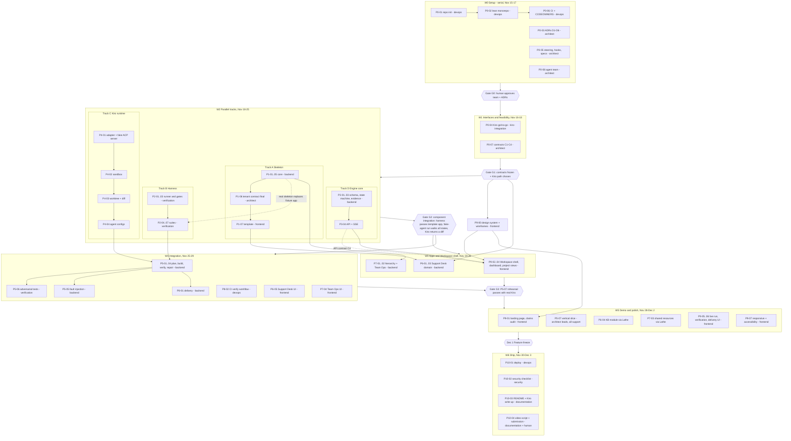
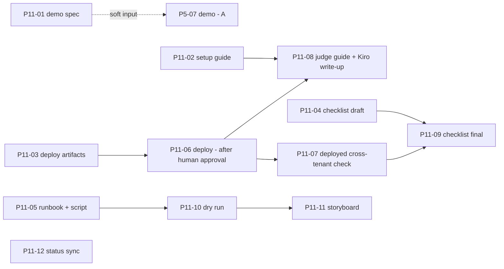

# Workstreams and dependency-aware parallel execution

Status: Proposed. Dates are from TASKLIST.md. Owners and reviewers: [task-ownership.md](task-ownership.md).

## Dependency diagram

## Waves and gates

| Wave | Dates | Parallel tracks (disjoint paths) | Exit gate |
|---|---|---|---|
| W0 | Nov 15–17 | devops scaffold; architect ADRs, steering, agents | G0: human approves agent team and ADRs D1–D6; CI green on empty packages |
| W1 | Nov 16–18 | kiro-integration spike ∥ architect contracts | G1 (Nov 17–18): Kiro path chosen with evidence; contracts C1–C4 frozen |
| W2 | Nov 18–25 | E design system P9-00 ∥ A skeleton (backend, frontend template) ∥ B harness (verification) ∥ C Kiro runtime (kiro-integration) ∥ D Engine core (backend) | G2: harness passes template app and fails every fixture; fake-agent run walks all states; Kiro returns a diff from the sandbox |
| W3 | Nov 20–26 | Support Desk domain ∥ hierarchy + Team Ops ∥ Workspace shell, dashboard, project views (P9-02..04) | Apps pass harness; Workspace shows real Engine data |
| W4 | Nov 25–29 | Pipeline ∥ delivery ∥ adversarial tests ∥ app UIs | G3: P5-07 rehearsal passes with real Kiro |
| W5 | Nov 28–Dec 2 | Demo ∥ Lathe-generated modules ∥ landing page and Workspace polish (P9-01, P9-06, P9-07) ∥ Team C: demo spec, setup guide, deploy artifacts, checklist draft, runbook (P11-01..05, Nov 28–29) | Dec 1 feature freeze |
| W6 | Nov 30–Dec 3 | Deploy ∥ checklist ∥ docs ∥ video ∥ Team C: deploy, deployed cross-tenant check, judge guide, checklist final, dry run, storyboard, status sync (P11-06..12, Nov 30–Dec 1) | Submitted by Dec 3 |

## What is safe to run in parallel

| Parallel pair | Why safe |
|---|---|
| backend (packages/application-foundation) ∥ backend (services/factory-engine) | Different paths. Share only frozen contracts |
| kiro-integration ∥ backend | Adapter contract C2 frozen; backend uses the fake adapter from kiro-integration |
| verification ∥ backend | Verification uses tenant contract C1 and a fixture app until the real skeleton exists |
| frontend (Workspace) ∥ backend (Engine API) | API contract C4 frozen; Workspace calls the real Engine in tests, so the Engine must reach a minimal API first (P3-04) |
| devops ∥ everyone | Owns separate files; dependency additions go through package owners |
| documentation ∥ everyone | Reads reports; writes only docs |
| Team C (P11) ∥ A and B | Team C paths (`specs/**`, `infra/deploy/**`, `tests/e2e/**`, `docs/setup/**`, `docs/security/**`, `docs/demo/**`, `docs/judge-guide.md`) are disjoint from A's and B's. No A or B task depends on C, except P5-07 consuming the demo spec P11-01 (soft: A can write the spec if P11-01 slips) |
| security review ∥ next task of the author | Review verdicts gate the **merge** of a task, not the start of the next independent task |

## What must be serialized

| Serial pair | Reason |
|---|---|
| P0-01 → P0-02 → P0-06 | Repo, then scaffold, then CI |
| P0-07 (contracts) → every consumer | Interfaces first |
| P1-02 tenancy → P1-05 `defineAction` → P1-06 contract final → P2-04/05 suites on real skeleton | Each layer builds on the one below |
| P4-01 adapter → P4-02 sandbox → P4-03 worktree | Sandbox needs the adapter's process model |
| P5-03 verification step → P5-04 repair loop → P5-06 adversarial tests | Each step consumes the previous |
| Any change to a frozen contract | Handoff, architect approval, consumer acknowledgment, then edit |
| Edits to `pnpm-lock.yaml` | Generated. Re-run `pnpm install` after rebase |
| Any task touching `packages/verification-harness/` or `.github/` | Only the owner writes; others hand off |
| P11-06 deploy after human approval of the host (D13) and of the deploy | Agents and C never deploy without A's explicit approval |
| `README.md` edits | C only from Nov 30; before that, handoff to C. Others send handoffs after that |

## Team C sequencing
P11-01, P11-02, P11-04 and P11-05 run in parallel on Nov 28–29. P11-03 starts Nov 29, then P11-06 → P11-07 → P11-09. P11-02 and P11-06 → P11-08. P11-05 → P11-10 → P11-11. P11-12 runs any time. Team C is not on the critical path; the critical path below is unchanged.

## Critical path

P0-02 → P0-07 → P1-02/05 → P1-06 → P2-04/05 → P5-03 → P5-04 → P5-07 → P10-04. Delay on this path moves the submission. P0-04 (Kiro spike) is an off-path risk that can change the whole plan, so it starts first.
