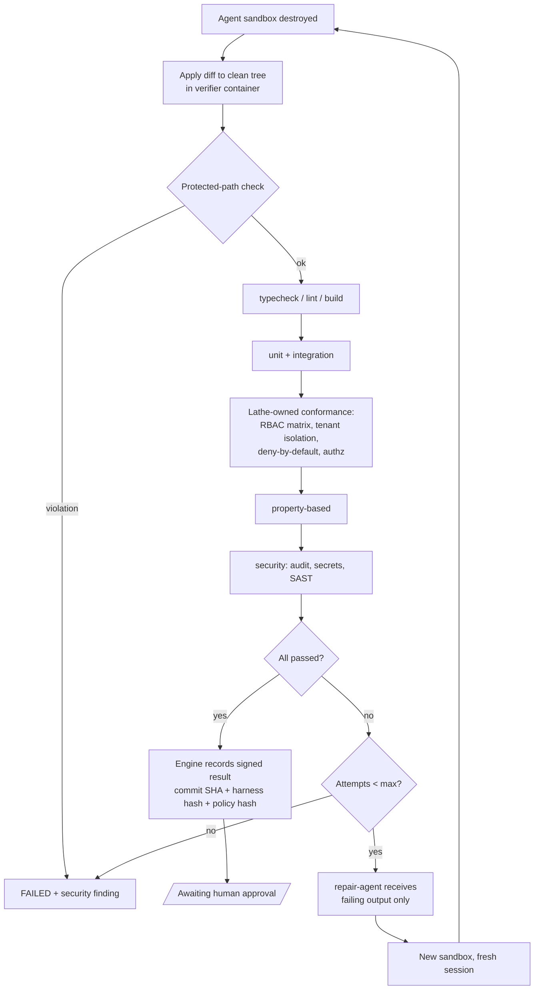

# 5. Verification and repair loop (Proposed)

Rules: the repair agent never sees or edits harness or policies. Max attempts and token/time budget come from `policies/`. Same failure repeating twice escalates to a human.
