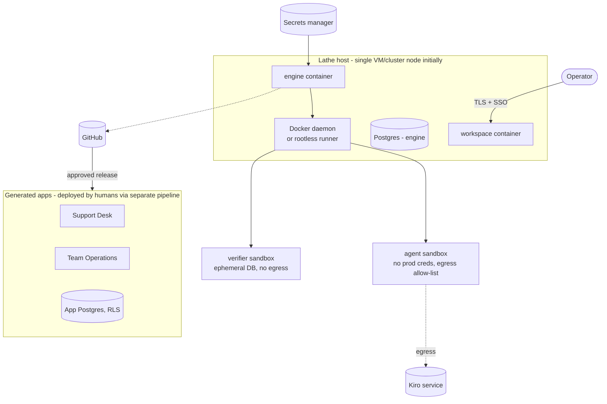

# 8. Deployment architecture (Proposed)

Kiroween MVP: the control plane runs on a trusted operator machine (Windows host, sandboxes in WSL2 Docker). It is not publicly hosted. Only the two generated apps, and optionally a read-only replay Workspace, are public.

Agent sandboxes never receive production credentials, GitHub write tokens, or the Engine DB URL. The Engine holds them.
