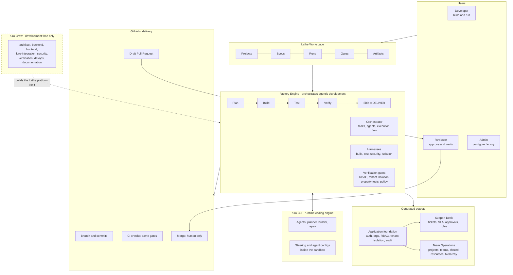

# 9. Mini Software Factory: product architecture overview (Proposed)

Redrawn from the project owner's reference image "Lathe: Mini Software Factory Architecture". The image file itself is not in the repository yet. Save it as `docs/architecture/reference/lathe-architecture-overview.png` and link it here. Solid boxes are in the MVP. Dashed boxes are development-time only or post-MVP.

End-to-end flow (as product copy): **Define** specs and rules → **Plan** → **Build** with Kiro agents → **Test** → **Verify** security and isolation → **Ship** a draft PR for review.

## Differences from the reference image (decided, not accidental)

| Reference image | This architecture | Reason |
|---|---|---|
| "Merge / Release" under GitHub | Merge is a human action on GitHub. The Engine has no merge, approve or deploy call. No release step in the MVP | Human approval and no agent-driven deploy (`security.md`) |
| Kiro box lists Specs, Steering, Agents, Hooks, MCP | Runtime uses agents and steering inside the sandbox. Hooks and MCP are used by the dev-time team, not by Lathe at runtime. No MCP is planned for the runtime | Smallest runtime surface; MCP only if it earns its place (`docs/kiro-usage.md` §6) |
| Kiro Crew shows four agents | Eight dev-time agents (`.kiro/agents/`) | See `docs/agents/team.md` |
| Workspace tabs: Projects, Specs, Runs, Gates, Artifacts | Navigation per P9-02: Overview, Projects, Specifications, Factory Runs, Agents, Verification, Deliveries, Settings. "Gates" maps to Verification, "Artifacts" to evidence and diffs inside runs and deliveries | Matches the approved P9 task list; every page must show real Engine data |
| "Ship" as the last step | UI label for the DELIVER state. Ship means draft PR with evidence plus human approval | Keeps the product from claiming deployment |
| Step list Plan, Build, Test, Verify, Ship (image flow starts at Define) | Canonical states: DEFINE, PLAN, BUILD, TEST, VERIFY, DELIVER | Same sequence; the UI shows Ship for DELIVER |
