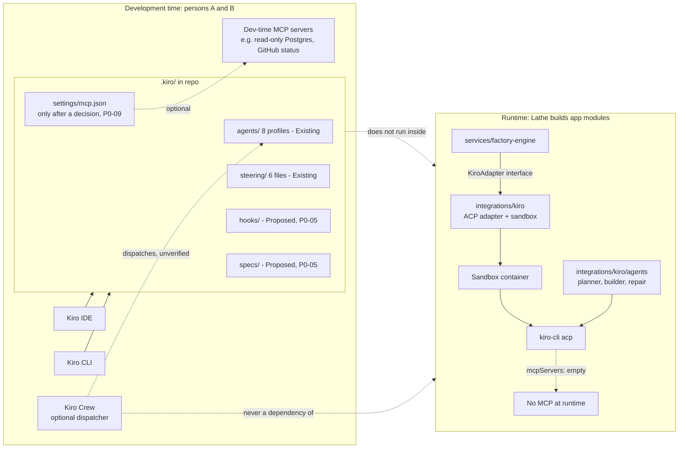

# 10. Where Kiro features are used: Crew, MCP, agents, steering, hooks, specs (Proposed)

Status of every item below is **Proposed** unless marked Existing. Existing means the file is in the repository. Nothing here has been run inside Kiro yet. Evidence is collected in `docs/kiro-usage.md` §9.

## Kiro Crew: where it is used

| Question | Answer |
|---|---|
| Used at runtime? | **No.** No documented embeddable runtime API. Nothing in `services/`, `integrations/`, `packages/` or `apps/` may depend on it (`.kiro/steering/architecture.md`). |
| Used in development? | **Optional.** As a dispatcher/conductor for the 8 dev-time agents, following the waves in `docs/agents/workstreams.md`. |
| Where is it visible in the repo? | `.kiro/agents/*.md` (the profiles a dispatcher would run), `docs/agents/` (ownership, waves, handoffs), `docs/kiro-usage.md` (evidence log). There is no Crew-specific code. |
| Observed on this machine | Global Crew agent profiles exist in `~/.kiro/agents/` (`kirocrew-conductor`, `kirocrew-team-lead`, `kirocrew-worker`, and others). They are outside the repository. |
| **Unverified** | Whether Crew can select the workspace profiles in `.kiro/agents/` and honour their `permissions` rules. Task **P0-09** checks this. Until then, each person starts agent sessions by hand in the IDE or CLI, and the plan does not depend on Crew. |

## MCP: where it is used

| Layer | Decision | Why |
|---|---|---|
| Lathe runtime sessions | **No MCP servers.** The adapter creates sessions with `mcpServers: []`. | Least privilege; sandbox has an egress allow-list; fewer prompt-injection paths. |
| Dev-time, workspace config | `.kiro/settings/mcp.json` is **not created yet**. It is added only if P0-09 finds a server that removes a concrete step. | Do not add tooling for its own sake. If none is adopted, `docs/kiro-usage.md` says so. |
| Candidate: read-only Postgres | Inspect schema and RLS policies while building `application-foundation`. Connect only to the local dev database with a read-only role. Never production. Tool access limited to `backend`, `verification`, `security` through their profile `tools` lists. | Would speed up RLS debugging and security review. |
| Candidate: GitHub (status only) | Read PR and CI status for `devops` and `documentation`. No write tools. | Evidence collection for delivery tasks. |
| Secrets | Server credentials come from environment variables expanded as `${VAR}` in the config (documented Kiro behaviour), never written into the file. | `.kiro/` is committed and public. |
| Not planned | Exposing Lathe itself as an MCP server. | Revisit after P5-07 only if there is time. |

## Other Kiro features

| Feature | Dev time | Runtime |
|---|---|---|
| Custom agents | `.kiro/agents/` (8, Existing) | `integrations/kiro/agents/` (planner, builder, repair; P4-04) |
| Steering | `.kiro/steering/` (6, Existing) | Steering copied into the sandbox's `.kiro/` for generated modules (P4-04) |
| Hooks | `.kiro/hooks/` (P0-05) | None |
| Specs | `.kiro/specs/` per phase (P0-05) | `specs/` hold product specs that Lathe runs consume. They are inputs, not Kiro specs |
| Powers | To be evaluated in P0-09; none chosen | None |
